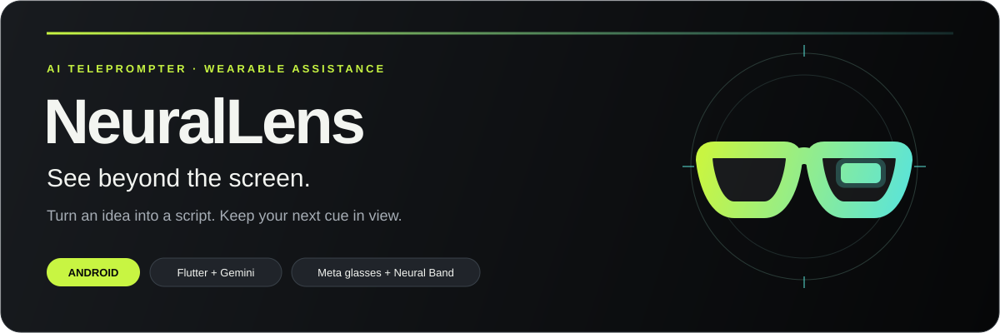

<p align="center">
  
</p>

<p align="center">
  <strong>Your ideas. Your words. Your next cue, in view.</strong><br />
  AI-assisted writing, a phone teleprompter, and gesture-controlled cues on Meta Ray-Ban Display glasses.
</p>

<p align="center">
  📱 <strong>Android</strong> &nbsp;·&nbsp;
  🕶️ <strong>Tested on real hardware</strong> &nbsp;·&nbsp;
  🍎 <strong>iOS coming next</strong>
</p>

<p align="center">
  <a href="#the-experience">The experience</a> ·
  <a href="#getting-started">Try it locally</a> ·
  <a href="#roadmap">What's next</a> ·
  <a href="LICENSE">MIT license</a> ·
  <a href="https://www.linkedin.com/in/priyanshubej/">LinkedIn</a> ·
  <a href="https://www.priyanshubej.com/">Portfolio</a>
</p>

---

## ✨ From a rough idea to a confident delivery

NeuralLens helps you **turn a topic into a script**, organize it into **short cue cards**, and keep those cues in view while you speak. Use it on your phone or bring the experience to **Meta Ray-Ban Display glasses** with **Neural Band gesture controls**.

I have tested the core teleprompter workflow on **my physical Meta glasses and Neural Band**: creating topics, scripts, and cue cards with AI, displaying the cues, and navigating them while presenting. That experience is working well. The AI agent work also forms part of my tested setup; its client integration lives on a separate branch.

This README describes the code on `develop`. The [roadmap](#roadmap) links to the agent and question-assistant branches so you can follow the work beyond the current app.

<a id="the-experience"></a>

## 🎬 The experience

| ✍️ Prepare | 🕶️ Present | 🤏 Stay in control |
| --- | --- | --- |
| **Start with an idea.** Turn a topic or rough notes into a script and readable cue cards. | **Keep your cues in view.** Read from the phone teleprompter or use display glasses. | **Find your rhythm.** Navigate with the Neural Band, adjust your pace, and pick up where you left off. |

## 💡 Why I built it

I wanted to make presenting feel more natural. Preparing often means switching between a writing tool, notes, and a teleprompter. During delivery, looking down at a phone can interrupt your connection with the audience.

NeuralLens brings preparation and delivery into one workflow. It is designed to help students, educators, creators, and professionals:

- **Prepare faster:** turn a topic or rough notes into a structured first draft.
- **Speak with more confidence:** follow short cues instead of memorizing every line.
- **Stay focused on the audience:** keep prompts in view on compatible display glasses.
- **Keep control of the script:** edit freely and review AI changes before applying them.
- **Start with the hardware they have:** use the phone teleprompter and glasses simulator without buying glasses.

## 🧩 What the app does

### ✨ AI Script Studio

- **Generate scripts** from a topic or rough notes with Google Gemini.
- Choose a **target duration, tone, and format**: presentation, YouTube video, Instagram Reel, podcast, meeting, or custom.
- Revise existing text with your own instructions.
- Turn a script into sections with short headings and cue keywords.
- **Preview revisions** and cue sections before replacing your text.
- Retry or regenerate responses, with feedback for configuration, network, and API errors.

The language selector currently supports **English** on `develop`. Additional language work is on the roadmap.

### 📚 Script editor and offline library

- Create and edit scripts or notes with **autosave**.
- Search and filter your library; organize items with favorites and tags.
- Duplicate scripts and confirm before deleting them.
- Store scripts **locally in SQLite** and preferences in SharedPreferences.

### 📱 Phone teleprompter

- Smooth scrolling with a reading-line marker.
- **Adjustable speed and font size**, plus mirror mode.
- Previous/next cue and section controls, restart, and progress display.
- Keep the screen awake while presenting.
- **Save your reading position** when you pause or leave.

### 🕶️ Glasses and Neural Band integration

- Native Kotlin bridge to Meta's Wearables Device Access Toolkit (DAT), pinned to **1.0.0**.
- Registration through Meta AI and connection to display-capable glasses.
- Compact cues designed for the glasses' 600 × 600 display.
- **Neural Band and glasses touch input** for navigating cues and controlling playback, subject to SDK capability access.
- Configurable navigation direction and select-button behavior.
- A phone-based glasses simulator for development and rehearsal.

Display output targets **Meta Ray-Ban Display** glasses. Standard glasses without a display cannot show these visual cues. The simulator is a preview on the phone and does not represent a live hardware connection.

## ▶️ A typical session

1. Open **AI Script Studio** and enter a topic, notes, tone, format, and duration—or write a script manually.
2. Review the draft, make changes, and optionally generate cue sections.
3. Save it to your library.
4. Start presenting in **Phone** mode or preview **Glasses** mode.
5. With compatible glasses connected, send cues to the display and use available wearable controls to navigate.

> [!TIP]
> **No glasses or API key? You can still try NeuralLens.** Local editing, saved scripts, phone teleprompting, and the simulator work without either. AI features require **your own Gemini API key and an internet connection**.

---

<a id="roadmap"></a>

## 🚀 What's next

The next focus is **conversational AI in Meta glasses**: moving from prepared speaking cues toward an assistant that can help with questions and follow-up conversations.

| Area | Status and next step |
| --- | --- |
| AI writing, local library, and phone teleprompter | **✅ Implemented** on `develop`. |
| Glasses display and Neural Band controls | **✅ Tested on hardware.** Core teleprompter workflow tested by the author on physical glasses and Neural Band. Continuing to refine comfort, readability, and interactions. |
| Camera-based question assistant | **🛠️ Prototype** on [`feature/meta-glasses-ai-conversational-assistant`](https://github.com/Priyanshu-Bej/NeuralLens-AI/tree/feature/meta-glasses-ai-conversational-assistant). Explicit photo capture, Gemini question analysis, full answers on the phone, and concise answers for the glasses. Not merged into `develop`; hardware validation remains. |
| Conversational AI in glasses | **🔭 Planned:** voice questions, context-aware follow-ups, and concise responses suited to a wearable experience. Depends on supported SDK capabilities and permissions. |
| AI agent integration | **✅ Working in the author's tested setup.** Client code is on [`feat/agent-backend`](https://github.com/Priyanshu-Bej/NeuralLens-AI/tree/feat/agent-backend), separate from `develop`. Public distribution still needs a review of backend deployment, authentication, and abuse controls. |
| More languages | **🧪 Experimental** work exists on `feat/agent-backend`; broader language support and validation remain. |
| iOS support | **🍎 Coming next.** The current working app is on Android; a native iOS glasses bridge still needs to be added. |

Roadmap items are development plans, not shipped features or release-date commitments.

---

<a id="getting-started"></a>

## ⚡ Getting started

### Requirements

- Flutter with Dart **3.12.2 or newer**, compatible with the constraints in [`pubspec.yaml`](pubspec.yaml).
- JDK **17 or newer** and an Android SDK configured for Flutter.
- An Android device or emulator running **Android 10 / API 29 or newer**.
- **Your own Gemini API key** for AI features; compatible glasses are optional for phone use.

Run `flutter doctor` to check your environment and `flutter doctor --android-licenses` to accept any outstanding Android SDK licenses.

### Run without AI or glasses

```bash
git clone --branch develop https://github.com/Priyanshu-Bej/NeuralLens-AI.git
cd NeuralLens-AI
flutter pub get
flutter run
```

You can create scripts manually, rehearse on your phone, and use the glasses simulator immediately.

### 🔑 Enable Gemini for local development

Create a key in [Google AI Studio](https://aistudio.google.com/apikey), then copy the configuration template:

```bash
cp .env.example .env
```

**Add your key as `GEMINI_API_KEY` in your local `.env`**, then run:

```bash
flutter run --dart-define-from-file=.env
```

The VS Code launch configurations already pass this flag. `GEMINI_MODEL` can override the model configured in [`AppConfig`](lib/core/config/app_config.dart); use a model available to your API project. `.env.example` contains configuration names and placeholders only.

For a local debug APK:

```bash
flutter build apk --debug --dart-define-from-file=.env
```

> [!IMPORTANT]
> **Keep API keys and key-bearing builds private.** Values passed through `--dart-define-from-file` are compiled into the app and can be extracted. Ignoring `.env` protects the source repository; it does not protect a key embedded in an APK. Public distribution needs an appropriate server-side credential design, authentication, and abuse controls.

### Connect Meta glasses

The app uses the pinned SDK integration in [`MetaWearablesBridge.kt`](android/app/src/main/kotlin/com/priyanshubej/neurallens/MetaWearablesBridge.kt). Consult the [official Wearables documentation](https://wearables.developer.meta.com/docs/develop/) for current device, firmware, developer access, and release requirements.

1. Set up compatible Meta Ray-Ban Display glasses and the Meta AI companion app.
2. Enable Developer Mode through Meta's current developer setup flow.
3. In NeuralLens, open **Glasses**, choose **Connect with Meta AI**, grant the requested Bluetooth permission, and approve registration.
4. Wear the glasses, choose **Connect glasses**, and start a script in **Glasses** mode.
5. For Neural Band input, enable the experimental Inputs capability for your app in the Wearables Developer Center. If unavailable or denied, use the phone controls.

The local developer configuration defaults to `0` for the Meta application ID and client token. If your registered configuration requires other values, put them in `.env`:

```properties
MWDAT_APPLICATION_ID=YOUR_APP_ID
MWDAT_CLIENT_TOKEN=YOUR_CLIENT_TOKEN
```

Gradle reads these values from `.env`, with `mwdat_application_id` and `mwdat_client_token` in `android/local.properties` as fallbacks. Both local files are ignored by Git. Register the `neurallens` callback scheme when configuring the app in the Developer Center.

### Current limitations

- The core teleprompter flow has been tested on the author's hardware; compatibility across other devices, firmware versions, and SDK configurations still needs broader testing.
- Glasses mode sends discrete cues over Bluetooth rather than smoothly scrolling the full script.
- Experimental SDK capabilities and distribution eligibility depend on Meta's current developer terms and access rules.
- The Android release configuration currently uses debug signing and needs a proper signing setup before distribution.
- iOS project files exist, but the glasses integration is Android-only.
- AI-generated scripts and answers need human review for accuracy.

## 🔒 Privacy and credentials

- **Scripts and notes are stored locally.** There is no account or cloud-sync feature on `develop`.
- **AI requests send the relevant text to Google Gemini** for generation, revision, or cue sections. Local storage does not mean AI processing happens offline.
- The Meta SDK has its own data practices and developer terms; see its [official repository](https://github.com/meta/meta-wearables-dat-android#developer-terms).
- **Never commit credentials:** `.env`, API keys, client tokens, signing keys, or private configuration. Keep `.env.example` free of real credentials.
- Before sharing a build, review its embedded configuration and the applicable service and SDK requirements.

## 🏗️ Under the hood

| Layer | Technology |
| --- | --- |
| App interface | Flutter and Dart |
| State management | `flutter_bloc` / Cubits |
| Navigation | `go_router` |
| AI | Gemini REST API with structured response validation |
| Local data | SQLite via `sqflite`; preferences via `shared_preferences` |
| Wearables | Dart platform channels → Kotlin → Meta Wearables DAT |
| Typography | Geist and Geist Mono, under SIL OFL 1.1 |

<details>
<summary><strong>📂 Explore the source structure</strong></summary>

```text
lib/
  main.dart, app.dart       App startup and dependency wiring
  core/                    Configuration, navigation, theme, shared widgets
  data/local/              SQLite database
  features/
    ai/                    Gemini client, prompts, generation workflow
    scripts/               Library, editor, cue segmentation, duration estimates
    presentation/          Playback state, phone teleprompter, glasses cues
    wearables/             Platform bridge, connection state, wearable inputs
    settings/              Preferences and settings interface
android/app/src/main/kotlin/com/priyanshubej/neurallens/
                           Native Android and Meta SDK integration
test/                      Unit, state-management, and widget tests
```

</details>

## 🧪 Development and checks

```bash
flutter pub get
flutter analyze
flutter test
```

The test suite covers cue segmentation, duration estimates, generated response parsing, mocked Gemini errors, script persistence, editor autosave, AI-revision confirmation, presentation state, wearable input mapping with a fake device, and launch without credentials or glasses. These checks do not replace testing on physical hardware.

Contributions, bug reports, and ideas are welcome. See [CONTRIBUTING.md](CONTRIBUTING.md) for the workflow and what to include in a report.

## 📄 License and reuse

Original NeuralLens code and documentation are available under the **[MIT License](LICENSE)**, copyright © 2026 Priyanshu Bej. You may **use, modify, and redistribute that code, including commercially**, provided you retain the copyright and license notice. The software is provided without warranty.

Third-party components retain their own licenses and terms. In particular, Geist fonts use SIL OFL 1.1, and Meta Wearables DAT is governed by Meta's developer terms. See [THIRD_PARTY_NOTICES.md](THIRD_PARTY_NOTICES.md) before redistributing the app or its dependencies.

NeuralLens is an independent project and is not affiliated with or endorsed by Meta, Ray-Ban, or Google. Their names and marks belong to their respective owners.

---

## 👋 Built by Priyanshu Bej

I’m building NeuralLens with the hardware on my desk and a simple goal: make AI useful beyond the phone screen. The teleprompter is working today, and conversational assistance is where I want to take it next.

- 💼 **LinkedIn:** [Connect with me](https://www.linkedin.com/in/priyanshubej/)
- 🌐 **Portfolio:** [priyanshubej.com](https://www.priyanshubej.com/)
- 💻 **GitHub:** [Priyanshu-Bej](https://github.com/Priyanshu-Bej)

For project feedback or collaboration, reach out on LinkedIn or open a [GitHub issue](https://github.com/Priyanshu-Bej/NeuralLens-AI/issues).
